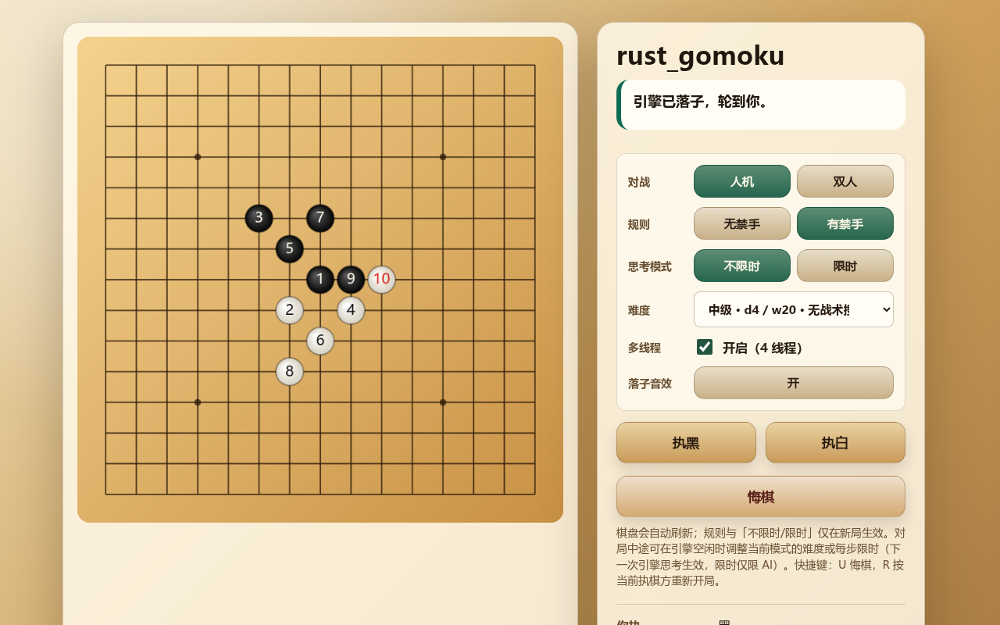
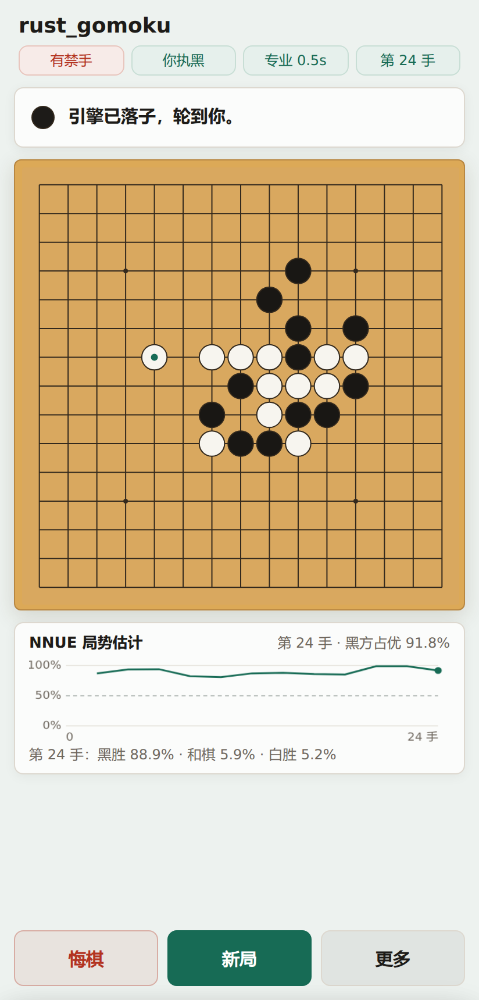
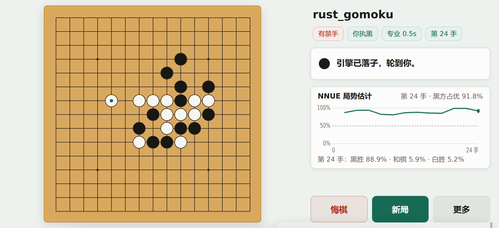

# rust_gomoku

`rust_gomoku` 是 Python reference 项目 `pygomoku` classic 主线的 Rust 重构，并支持可选的连珠禁手规则。当前主线目标是同时守住两种规则的正确性，在可验证的前提下继续降低搜索耗时并提高棋力。

## 界面截图

Windows x64 程序和已签名的 Android ARM64 APK / AAB 可从[最新 Release](https://github.com/chubbyk-uu/rust-gomoku/releases/latest)下载。

### Windows / 桌面 GUI

Windows 程序启动后打开本地网页界面。可与引擎对弈或进行双人对局，在右侧选择无禁手或连珠规则、切换不限时（五档难度）或限时（每步时间上限）思考模式，并可开关多线程搜索。



### Android

手机界面集中展示棋盘、当前回合，以及悔棋和新局操作。支持不限时（入门、初级、中级、高级、大师五档难度，默认中级）和限时（每步 `200 ms`–`5000 ms`）两种思考模式，以及多线程搜索开关。

<p>
  
  
</p>

横屏时，操作区排列在棋盘旁边：



截图说明：桌面图截自 WSL 中实际运行的 GUI，与 Windows 版本使用同一网页。Android 图片使用应用内置的 HTML/CSS/JavaScript 和 Rust 控制器产生的真实对局状态，在浏览器中预览截取，不含 Android 系统栏，非手机实机截图。

## 当前状态

已完成：

- 15x15 无禁手与连珠规则状态机、zobrist、配置、pattern、eval cache、movegen、ordering、TT、alpha-beta root search。
- 连珠黑方长连、四四、递归真三三禁手及五连优先语义；默认规则仍为无禁手。
- 规则感知的 root VCF、root-only VCT 触发/验证/trace。
- Gomocup stdin/stdout 引擎入口和本地 Web GUI。
- Rust/reference 差分、Rust/reference 对战、双引擎对战和同局面 benchmark 脚手架。
- 连珠 oracle、定向密集压测、一维穷举、候选诊断、性能测试和规则感知对局裁判工具。
- 非 root 候选排序成本优化：保持原排序 key 不变，减少 `getmi` 和候选复制开销（惰性 tie-group `getmi` + TT best move 延迟主排序）。
- 四方向增量 `Pattern4` 位棋盘/LUT 战术加速（VCF 与 VCT），在连珠密集 VCT6 局面提速 `5.5x`–`8.6x`，包含精确连珠活三超集过滤（`maybe_33`）及白棋 `B4` 落子后对黑方禁手防点的复验。
- 多线程 ABDADA 搜索（`--threads N` / `INFO thread_num N`），配备 `1/64` 层细粒度 TT 深度编码（`store = floor(d * 64)`、`probe = ceil(d * 64)`，编码上限 50 层；超过 50 层仅使用 TT 走法提示）、完整子层替换优先级，以及按单/多线程模式隔离的双平面共享置换表。
- SlowRenju、Rapfi 等外部参考引擎按需从本地 checkout 使用；仓库不再提交轻量对手或完整 Python reference。

可选诊断/实验：

- `overlap_vct_alphabeta`：VCF miss 后重叠 VCT 与 alphabeta 的实验开关。
- `root_profile`：root candidate 计时诊断。
- TT generation 观测：Gomocup trace 可输出跨手 TT best-move hint 新旧比例，不影响 TT cutoff、replacement 或排序策略。

GUI 入口仅在单线程（`--threads 1`）手动对局时默认开启 `overlap_vct_alphabeta`；多线程模式下保持关闭以避免额外 64 MiB TT 快照与核心争抢。Gomocup、diff、case probe 和库默认均保持关闭。
历史性能实验和止损结论记录在 `docs/perf-log.md`，README 不重复维护失败方案清单。
Android 架构、手机界面、JNI 边界和分阶段验证门槛记录在
`docs/android-app-design.md`。Android 应用可构建 ARM64 debug 与已签名
release 产物（APK / AAB），并通过 JNI 使用共享 Rust 控制器。

## 默认参数

主要默认值集中在 `src/config.rs`。

| 参数 | 默认值 |
|---|---:|
| 固定搜索深度 | `8` |
| 固定 root width | `40` |
| 时间控制最大深度 | `25` |
| 时间控制最大 width | `40` |
| `root_vcf_depth` | `8` |
| `opponent_vcf_depth` | `7` |
| `vct_verify_opponent_vcf_depth` | `4` |
| `vcf_multi_reply` | `true` |
| `root_vct_depth` | `6` |
| `vct_strict_and_memo_key` | `true` |
| TT bucket bits | 1–3 线程或深度 `< 5` 为 `20`（32 MiB）；4+ 线程且深度 `>= 5` 自动为 `21`（64 MiB） |
| `threads` | 库/Gomocup 默认 `1`；桌面 GUI 与 Android 在 `>= 4` 核默认 `4`，`< 4` 核默认 `min(2, cores)`（支持 `--threads N` / `set_threads` 回退单线程） |
| `compute_vcf` / `compute_vct` | 开启 |
| `overlap_vct_alphabeta` | 关闭；GUI 仅在 `threads == 1` 时开启 |
| `nonroot_vcf` | 关闭 |
| `static_board` | 开启 |
| `dynamic_board_margin` | `4` |

桌面 GUI 和 Android 应用支持两种思考模式：

1. **不限时模式**（默认）——提供五档共享固定深度难度：

| 难度 | 搜索参数 | VCF / VCT |
|---|---:|---:|
| 入门 | `d1 / w10` | 关闭 |
| 初级 | `d2 / w10` | 关闭 |
| 中级 | `d4 / w20` | 关闭 |
| 高级 | `d6 / w30` | 开启，`root_vct_depth=6` |
| 大师 | `d8 / w40` | 开启，`root_vct_depth=6` |

中级是桌面 GUI 和 Android 应用的默认难度。难度控制深度、宽度和战术搜索。

2. **限时模式**——提供每步时间上限档位（`200 ms`、`500 ms`、`1000 ms`、`2000 ms`、`5000 ms`，默认 `500 ms`），在 `w40` 下迭代加深至最多 `d25` 并开启 VCF/VCT（限时模式下 root VCT 最多使用整手预算的 30%，确保未算杀成功时 alpha-beta 仍有充足搜索时间）。

与 Python reference 严格差分或复现实验时，通常显式使用 `depth=6,width=20,root_vct_depth=4`。

连珠模式实现轮流落子和黑方禁手；RIF、Yamaguchi、Soosorv、Swap2 等连珠开局协议尚未实现。

## 坐标约定

外部坐标统一为 `(x, y) = (列, 行)`，与 Gomocup、GUI 和 case JSON 保持一致。内部棋盘矩阵按 Rust 数组习惯存为 `grid[row][col]`，`Move` 编码为 `row * BOARD_SIZE + col`。代码里优先使用 `xy_to_move` / `move_to_xy`；在矩阵语境下可使用别名 `rc_to_move` / `move_to_rc` 避免误读。

## Reference 路径

完整 Python reference 默认放在本机外部目录：

```bash
~/python_ws/pygomoku
```

也可以显式指定：

```bash
export PYGOMOKU_REF_ROOT=~/python_ws/pygomoku
```

脚本查找顺序是 `--ref-root`、`PYGOMOKU_REF_ROOT`、`~/python_ws/pygomoku`。

## 常用命令

构建和测试：

```bash
cargo build --release
cargo test --quiet
python3 scripts/run_diff.py --jobs 10
```

Android debug/release 验证与构建：

```bash
cd android
./gradlew test lint assembleDebug
./gradlew test lint assembleRelease bundleRelease
```

Release 签名默认读取 `~/.android/rust-gomoku-release.properties`；本地签名文件格式和覆盖环境变量详见 `docs/android-app-design.md`。

Gomocup smoke：

```bash
printf 'START 15\nBEGIN\nEND\n' | cargo run --quiet --bin gomocup_engine -- --depth 2 --width 8
printf 'START 15\nINFO rule 4\nBEGIN\nEND\n' | cargo run --quiet --bin gomocup_engine -- --depth 2 --width 8
```

启动 GUI：

```bash
cargo run --release --bin gomoku_gui
```

GUI 会自动用默认浏览器打开 `http://127.0.0.1:18080`；如需关闭自动打开行为，可加 `--no-open-browser`。GUI 支持人机对战（执黑/执白）和双人对弈（两人在同一棋盘轮流落子、不启动引擎）两种对战模式，无禁手或连珠规则、不限时（五档难度）和限时（每步 `200 ms`–`5000 ms`）两种思考模式、多线程搜索开关、悔棋、重新开局、异步思考、手数显示、胜负弹窗和状态面板；快捷键 `U` 悔棋，`R` 重新开局。双人模式下会隐藏仅人机模式有意义的控件（执棋、思考模式、难度/每步限时、多线程）。空棋盘时切换对战模式、规则或思考模式会立即生效；落子后（`move_count > 0`）切换会显示待生效提示，并在点击开局按钮开始新局时生效。连珠黑方回合会用红叉标出禁手点，点击禁手点会被拒绝且不会落子（两种模式都如此）。难度、每步限时和多线程开关可在对局中途引擎空闲时随时调整，不重置当前棋局，只影响下一次引擎思考。

Gomocup engine：

```bash
cargo run --release --bin gomocup_engine
target/release/gomocup_engine --depth 8 --width 40
target/release/gomocup_engine --threads 4 --depth 8 --width 40
target/release/gomocup_engine --depth 6 --width 20 --root-profile
target/release/gomocup_engine --tt-bits 22
```

常用 `INFO`：

- `INFO rule 0|4` 或 `INFO rule freestyle|renju`（仅空棋盘时允许）
- `INFO timeout_turn N`
- `INFO time_left N`
- `INFO max_node N`
- `INFO thread_num N`（ABDADA 多线程搜索；`1` 保持单线程确定性）
- `INFO compute_vcf 0|1`
- `INFO root_vcf_depth N`
- `INFO opponent_vcf_depth N`
- `INFO vct_verify_opponent_vcf_depth N`
- `INFO vcf_multi_reply 0|1`
- `INFO compute_vct 0|1`
- `INFO root_vct_depth N`
- `INFO vct_strict_and_memo_key 0|1`
- `INFO nonroot_vcf 0|1`
- `INFO overlap_vct_alphabeta 0|1`
- `INFO tt_bits N`
- `INFO static 0|1`
- `INFO dynamic_board_margin N`
- `INFO root_profile 0|1`

VCF、VCT 与 alpha-beta 在一手棋内共用截止时间和累计节点预算。同时给出
`timeout_turn` 与 `time_left` 时取较小值；限时搜索下 root VCT 子预算上限为整手预算的 30%，确保未算杀时留出 alpha-beta 搜索时间。搜索采用协作式中止，完成当前棋盘
操作、选择合法后备手及协议初始化仍可能产生额外耗时。限额搜索报告的节点数
包含战术节点，无限额搜索沿用 alpha-beta 节点数。

运行 `scripts/run_diff.py --profile all --check-baselines` 可同时验证 TT 小数
深度及整手预算修正后 Rust 和 Python 各自的预期值。默认差分仍报告所有不同。
用 `scripts/bench_match_cases.py` 测 Renju 前缀时可指定 `--rule renju`。

## 差分和对战

单 case 差分：

```bash
cargo run --quiet --bin diff_probe -- --case cases/diff/root_center_11.json
cargo run --quiet --bin diff_probe -- --case cases/diff/root_center_11_d6_w5.json --root-profile
```

Rust 默认参数对 Python reference 9 开局双边 18 局：

```bash
cargo build --release --bin gomocup_engine
python3 scripts/run_engine_match.py \
  --opening-set 9 \
  --jobs 18 \
  --output /tmp/rust_vs_reference_9_openings.json
```

通用 engine 对战：

将 `BASELINE_DIR` 指向保存基线版 `gomocup_engine` 和 `case_probe` 发布构建的目录。

```bash
cargo build --release --bin gomocup_engine --bin case_probe
BASELINE_DIR=/path/to/baseline/bin
python3 scripts/run_gomocup_match.py \
  --case-file cases/match/smoke_quick.jsonl \
  --engine-a-side both \
  --engine-a-command 'target/release/gomocup_engine --depth 6 --width 20' \
  --engine-b-command "\"$BASELINE_DIR/gomocup_engine\" --depth 6 --width 20" \
  --output /tmp/engine_version_match.json
```

同局面一手 benchmark：

```bash
python3 scripts/bench_match_cases.py \
  --case-file cases/match/standard.jsonl \
  --baseline-binary "$BASELINE_DIR/case_probe" \
  --candidate-binary target/release/case_probe \
  --jobs 1 \
  --output /tmp/engine_version_bench.json
```

`run_gomocup_match.py` 用于真实对战和棋力评估；`bench_match_cases.py` 用于同一批前缀局面的一手搜索对照。判断优化是否真的提速，应先看同局面 benchmark，再看对战胜率和长尾耗时。

两侧使用相同引擎和选项时，对战脚本会标记为自对弈冒烟，benchmark 会标记为重复性检查。

引擎与 `case_probe` 已移除 Fast 配置及其 CLI 选项（`--profile`、`--fast-history-ordering`、`--no-fast-history-ordering`），直接使用默认配置。旧 Gomocup `INFO profile` 和 `INFO fast_history_ordering` 按未知选项处理。benchmark JSON 使用 `baseline` 和 `candidate` 标记两侧。

连珠对战使用 `--rule renju`。对战脚本会给双方设置 Gomocup 规则 `4`，
并使用规则感知裁判拒绝黑方禁手：

```bash
cargo build --release --bin gomocup_engine --bin renju_referee
python3 scripts/run_gomocup_match.py \
  --rule renju \
  --case-file cases/renju/strength_100_prefixes.jsonl \
  --engine-a-side both \
  --engine-a-command 'target/release/gomocup_engine --depth 8 --width 40' \
  --engine-b-command "\"$BASELINE_DIR/gomocup_engine\" --depth 8 --width 40"
```

完整连珠设计、验证证据、SlowRenju 对照约定和剩余工作见
`docs/renju-forbidden-design.md`。

如需观察真实跨手 TT，可给 `run_gomocup_match.py` 加 `--reuse-engine-state`。默认对战脚本每手 `RESTART`，更适合公平复现；`--reuse-engine-state` 会保留 engine/searcher 状态，并把每手 `MESSAGE tt_generation current=... old=...` 汇总到 JSON 的 `tt_generation` 字段。

## 目录

```text
src/                 Rust engine、Gomocup、GUI、diff/case probe
cases/diff/          root 差分 case
cases/match/         对战和 benchmark 前缀局面
cases/renju/         禁手、战术、候选诊断和棋力前缀 case
data/static/         从 reference 提取的静态矩阵
scripts/             差分、对战、benchmark、case 抽取脚本
tests/               Rust 自动测试
```

## 当前重点

1. 保留已经完成的 100 局固定深度 Rust vs SlowRenju 连珠门槛；后续扩样应增加独立来源对局，而不是继续截取同一批轨迹的相邻前缀。
2. 以当前优化后基线继续降低连珠每节点剩余开销和 VCF/VCT 长尾；性能改动必须通过 oracle、root diff 和棋力门槛。
3. 学习 Rapfi 的首要目标是提高棋力，重点审计候选排序、评估、战术搜索、TT、剪枝/延伸和时间管理；线模式与禁手表也可作为加深搜索的支撑。
4. 保留已经完成的无禁手门槛：100 局 Rust-vs-SlowRenju、当前版本与 Renju 前历史版本逐手等价、classic reference/Rust 差分，并用实验版本对当前主线的对局评估搜索改动。
5. 所有性能实验都要同时报告正确性、耗时、nodes、move/score/trace 是否变化。

## 许可证

本项目使用 GNU General Public License v3.0 或后续版本授权。详见 [LICENSE](LICENSE)。
