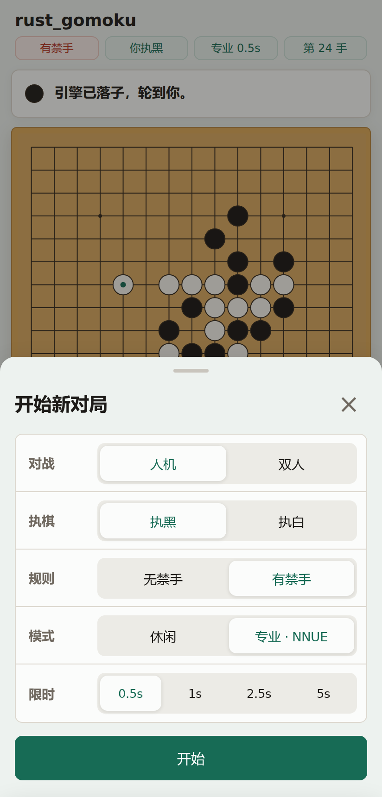

# rust_gomoku

`rust_gomoku` 是一个用 Rust 编写的 15×15 五子棋引擎，以实战限时下的棋力、规则正确性和搜索响应为目标。支持**自由五子棋（Freestyle）**和**连珠（Renju）**，提供桌面浏览器界面、Android 应用和 Gomocup 引擎。

[English](README.md) · [下载最新版](https://github.com/chubbyk-uu/rust-gomoku/releases/latest) · [文档目录](docs/README.md)

## 下载和对弈

| 平台 | 如何开始 |
|---|---|
| Windows x64 | 解压发布 ZIP，运行 `gomoku_gui.exe`，浏览器会打开棋盘。使用专业模式时，把随附的 `nnue/` 目录留在程序旁边。 |
| Android ARM64 | 从发布页下载并安装签名 APK，已包含两种规则的权重。发布页也提供用于分发的 AAB。 |
| Linux 或 Gomocup | 从源码构建后运行桌面界面，或按下文启动 `gomocup_engine`。 |

桌面和 Android 均支持人机对弈和本地双人对弈。连珠模式下，棋盘会标出黑方禁手并拦截落子。

| 模式 | 搜索与选项 |
|---|---|
| **专业** | 原生 `Mix9svq` NNUE，默认**单手 1 秒**，可选 0.5、2.5 或 5 秒。支持多线程切换和局势胜率估计曲线。 |
| **休闲** | 使用经典固定深度搜索，分入门、普通、高级和大师四档。无需 NNUE 权重。 |

## 界面截图

**桌面 · 连珠专业模式。** 右侧显示 NNUE 胜率估计曲线和最近一手的搜索耗时。


**Android · 对局和新局设置。** 这是发布包中 Android 界面的浏览器预览，连接开发机上的 Rust JNI 桥接运行。

<p>
  
  
</p>

[查看 Android 横屏布局](docs/screenshots/android-landscape.png)。

## 引擎

原生 NNUE 搜索使用增量棋型与评估、QVCF 战术搜索和 Lazy SMP。推理在支持的 x86-64 CPU 上使用 AVX2 或 AVX-VNNI，在 ARM64 上使用 NEON，并在支持时启用点积加速。

自由五子棋黑白共用一套 Mix9svq 权重，连珠黑白分别加载各自的权重。项目使用兼容的 Rapfi 权重，文件名、查找顺序和经典模式参数见[引擎指南](docs/engine.md#nnue-weights)。

## 从源码构建

```bash
cargo build --release --locked
cargo test --locked
cargo run --release --bin gomoku_gui
```

桌面界面会打开 `http://127.0.0.1:18080`。如需指定权重目录，运行 `cargo run --release --bin gomoku_gui -- --nnue-dir /path/to/weights`。

### 启动 Gomocup 引擎

```bash
printf 'START 15\nINFO rule 4\nINFO timeout_turn 1000\nBEGIN\nEND\n' | \
  target/release/gomocup_engine --nnue-dir /path/to/weights --threads 4
```

`INFO rule 4` 选择连珠，`INFO rule 0` 选择自由五子棋。Gomocup 未配置权重目录时使用经典搜索。局时、内存、固定深度和诊断参数见 [Gomocup 指南](docs/gomocup.md)，构建和签名见 [Android 指南](docs/android-app-design.md)。

## 棋力评测

`v0.1.21` 发布前验证的引擎在与 Rapfi 的 **600 局**对战中得分 **50.92%**。双方使用相同权重和线程数，每个开局换色各打一局，单手限时 1 秒。和棋计半分。

| 对战 | 局数 | 胜–负–和 | 得分率 |
|---|---:|---:|---:|
| Freestyle 1T | 100 | 39–40–21 | 49.50% |
| Freestyle 4T | 100 | 43–34–23 | 54.50% |
| Renju 1T | 200 | 85–84–31 | 50.25% |
| Renju 4T | 200 | 82–80–38 | 50.50% |

总得分率的 95% 区间为 **49.25%–52.58%**。同配置复跑 Renju 1T 得分 **53.00%**，两轮合计 **51.63%**。各组耗时、参数和配对比较见[棋力日志](docs/perf-log.md)。

## 开发

[评测指南](docs/testing.md)提供对战命令、规则用例及固定局面回归方法。[文档目录](docs/README.md)还包括引擎、连珠规则和[当前路线图](docs/optimization-roadmap.md)。

## 许可证

项目采用 [GPL-3.0-or-later](LICENSE)。网络权重是独立资源，许可见对应发布来源。
