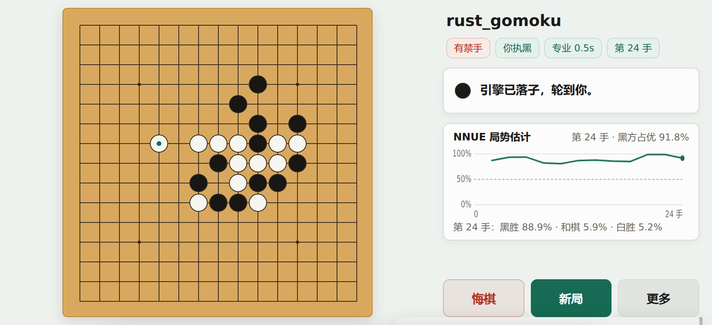

# rust_gomoku

`rust_gomoku` is a Rust rewrite of the classic mainline of the Python reference project `pygomoku`, with optional Renju forbidden-move support. Current work preserves both rule modes while reducing search latency and improving playing strength through measured experiments.

A Chinese version of this document is available at [README-cn.md](README-cn.md).

## Screenshots

Download the Windows x64 program and signed Android ARM64 APK from the [latest release](https://github.com/chubbyk-uu/rust-gomoku/releases/latest).

### Windows / Desktop GUI

The Windows program opens this local browser interface. Play against the engine or another person, choose freestyle or Renju, and adjust difficulty from the side panel.


### Android

The mobile interface puts the board, turn status, and undo/new-game controls together. Five difficulty levels range from Beginner to Master; Intermediate is the default.

<p>
  
  
</p>

Landscape mode places the controls beside the board:



Capture notes: the desktop screenshot was taken from the running GUI in WSL, which serves the same page as the Windows build. Android images are browser previews of the app's bundled HTML/CSS/JavaScript using a real Rust-controller game snapshot, without Android system bars. They are not device screenshots.

## Current Status

Completed:

- 15x15 freestyle and Renju state machine, zobrist, config, pattern, eval cache, movegen, ordering, TT, and alpha-beta root search.
- Renju black forbidden-move handling for overline, double-four, and recursive true double-three, with exact-five priority; freestyle remains the default.
- Rule-aware root VCF and root-only VCT trigger/verify/trace.
- Gomocup stdin/stdout engine entry point and a local Web GUI.
- Rust/reference diff harness, Rust/reference matches, head-to-head matches, and same-position benchmark scaffolding.
- Renju oracle, dense-stress, exhaustive-line, candidate-diagnostic, performance, and rule-aware match-referee tooling.
- Non-root candidate ordering cost optimization: keeps the original ordering key while reducing `getmi` and candidate copy overhead (lazy tie-group `getmi` + TT-best-move deferred primary sort).
- External reference engines such as SlowRenju and Rapfi are used from local
  checkouts when needed; bundled lightweight opponents are no longer committed.

Optional diagnostics / experiments:

- `overlap_vct_alphabeta`: experimental switch to overlap VCT with alpha-beta after a VCF miss.
- `root_profile`: per-root-candidate timing diagnostics.
- TT generation observation: Gomocup trace can report the new/old ratio of cross-move TT best-move hints. It does not affect TT cutoff, replacement, or ordering policy.

To shorten the perceived wait during manual GUI play, the GUI entry enables `overlap_vct_alphabeta` by default; Gomocup, diff, case probe, and the library still keep it off.
Historical performance experiments and stop-loss conclusions are recorded in `docs/perf-log.md`; the README does not maintain a list of failed approaches.
The Android architecture, mobile interface, JNI boundary, phased validation
gates, and current implementation status are documented in
`docs/android-app-design.md`. The Android app builds ARM64 debug and signed
release artifacts and uses the shared Rust controller through the tested JNI
bridge.

## Default Parameters

The main defaults live in `src/config.rs`.

| Parameter | Default |
|---|---:|
| Fixed search depth | `8` |
| Fixed root width | `40` |
| Time-control max depth | `25` |
| Time-control max width | `40` |
| `root_vcf_depth` | `8` |
| `opponent_vcf_depth` | `7` |
| `vct_verify_opponent_vcf_depth` | `4` |
| `vcf_multi_reply` | `true` |
| `root_vct_depth` | `6` |
| `vct_strict_and_memo_key` | `true` |
| TT bucket bits | `20` (32 MiB) for 1–3 threads; `21` (64 MiB) for 4+ threads |
| `threads` | `1` (lib/Gomocup); `4` on 4+ cores or `min(2, cores)` on `< 4` cores (GUI & Android) |
| `compute_vcf` / `compute_vct` | enabled |
| `overlap_vct_alphabeta` | off; GUI entry turns it on |
| `nonroot_vcf` | off |
| `static_board` | on |
| `dynamic_board_margin` | `4` |

The desktop GUI and Android app expose five shared difficulty presets:

| Difficulty | Search | VCF / VCT |
|---|---:|---:|
| Beginner | `d1 / w10` | off |
| Junior | `d2 / w10` | off |
| Intermediate | `d4 / w20` | off |
| Senior | `d6 / w30` | on, `root_vct_depth=6` |
| Master | `d8 / w40` | on, `root_vct_depth=6` |

Intermediate is the default for the desktop GUI and Android app. Difficulty controls depth, width, and tactical search.

For strict diffs against the Python reference or reproducing reference experiments, `depth=6,width=20,root_vct_depth=4` is typically passed explicitly.

Renju mode implements alternating play plus black forbidden moves. Renju opening protocols such as RIF, Yamaguchi, Soosorv, and Swap2 are not implemented.

## Coordinate Convention

External coordinates are uniformly `(x, y) = (column, row)`, matching Gomocup, the GUI, and case JSON files. Internally, the board matrix follows Rust array conventions as `grid[row][col]`, and `Move` is encoded as `row * BOARD_SIZE + col`. Prefer `xy_to_move` / `move_to_xy` in code; in matrix contexts the aliases `rc_to_move` / `move_to_rc` can be used to avoid confusion.

## Reference Path

The full Python reference is expected to live in an external local directory by default:

```bash
~/python_ws/pygomoku
```

You can also point to it explicitly:

```bash
export PYGOMOKU_REF_ROOT=~/python_ws/pygomoku
```

Scripts resolve the reference in this order: `--ref-root`, `PYGOMOKU_REF_ROOT`, then `~/python_ws/pygomoku`.

## Common Commands

Build and test:

```bash
cargo build --release
cargo test --quiet
python3 scripts/run_diff.py --jobs 10
```

Android debug/release gates:

```bash
cd android
./gradlew test lint assembleDebug
./gradlew test lint assembleRelease bundleRelease
```

Release signing reads `~/.android/rust-gomoku-release.properties` by default;
see `docs/android-app-design.md` for the local signing file format and override
environment variable.

Gomocup smoke:

```bash
printf 'START 15\nBEGIN\nEND\n' | cargo run --quiet --bin gomocup_engine -- --depth 2 --width 8
printf 'START 15\nINFO rule 4\nBEGIN\nEND\n' | cargo run --quiet --bin gomocup_engine -- --depth 2 --width 8
```

Launch the GUI:

```bash
cargo run --release --bin gomoku_gui
```

The GUI opens `http://127.0.0.1:18080` in the default browser automatically; pass `--no-open-browser` to disable that behavior. It supports a vs-engine mode (playing black/white) and a two-player mode (two humans alternating on the same board with no engine), freestyle or Renju rules, five difficulty levels, undo, restart, async thinking, move number display, a result dialog, and a status panel; shortcuts: `U` to undo, `R` to restart. The engine-only controls (side, difficulty) are hidden in two-player mode. Rule selection applies only when starting a new game. During a Renju black turn, forbidden intersections are marked with red crosses and forbidden input is rejected without placing a stone (this holds in both modes). Difficulty can only change while the engine is idle and affects the next engine think without resetting the board.

Gomocup engine:

```bash
cargo run --release --bin gomocup_engine
target/release/gomocup_engine --depth 8 --width 40
target/release/gomocup_engine --threads 4 --depth 8 --width 40
target/release/gomocup_engine --depth 6 --width 20 --root-profile
target/release/gomocup_engine --tt-bits 22
```

Common `INFO` commands:

- `INFO rule 0|4` or `INFO rule freestyle|renju` (only while the board is empty)
- `INFO timeout_turn N`
- `INFO time_left N`
- `INFO max_node N`
- `INFO thread_num N` (ABDADA multi-threaded search; `1` stays deterministic)
- `INFO compute_vcf 0|1`
- `INFO root_vcf_depth N`
- `INFO opponent_vcf_depth N`
- `INFO vct_verify_opponent_vcf_depth N`
- `INFO vcf_multi_reply 0|1`
- `INFO compute_vct 0|1`
- `INFO root_vct_depth N`
- `INFO vct_strict_and_memo_key 0|1`
- `INFO nonroot_vcf 0|1`
- `INFO overlap_vct_alphabeta 0|1`
- `INFO tt_bits N`
- `INFO static 0|1`
- `INFO dynamic_board_margin N`
- `INFO root_profile 0|1`

VCF, VCT and alpha-beta share a deadline and cumulative node budget across a move.
When both time controls are given the smaller limit applies. Cancellation is
cooperative. Finishing a board operation, selecting a legal fallback and
protocol setup can add wall time. Under a budget, the reported node count
includes tactical visits. Without limits it retains the alpha-beta count.

Use `scripts/run_diff.py --profile all --check-baselines` to verify pinned
Rust and Python values for fractional TT depth and whole-move budget changes.
The default diff still reports every mismatch. For same-position Renju
benchmarks pass `--rule renju` to `scripts/bench_match_cases.py`.

## Diffs and Matches

Single-case diff:

```bash
cargo run --quiet --bin diff_probe -- --case cases/diff/root_center_11.json
cargo run --quiet --bin diff_probe -- --case cases/diff/root_center_11_d6_w5.json --root-profile
```

Rust default parameters vs. the Python reference, 9 openings, both sides, 18 games:

```bash
cargo build --release --bin gomocup_engine
python3 scripts/run_engine_match.py \
  --opening-set 9 \
  --jobs 18 \
  --output /tmp/rust_vs_reference_9_openings.json
```

Generic engine match:

Set `BASELINE_DIR` to the directory containing the baseline release builds of `gomocup_engine` and `case_probe`.

```bash
cargo build --release --bin gomocup_engine --bin case_probe
BASELINE_DIR=/path/to/baseline/bin
python3 scripts/run_gomocup_match.py \
  --case-file cases/match/smoke_quick.jsonl \
  --engine-a-side both \
  --engine-a-command 'target/release/gomocup_engine --depth 6 --width 20' \
  --engine-b-command "\"$BASELINE_DIR/gomocup_engine\" --depth 6 --width 20" \
  --output /tmp/engine_version_match.json
```

Same-position single-move benchmark:

```bash
python3 scripts/bench_match_cases.py \
  --case-file cases/match/standard.jsonl \
  --baseline-binary "$BASELINE_DIR/case_probe" \
  --candidate-binary target/release/case_probe \
  --jobs 1 \
  --output /tmp/engine_version_bench.json
```

`run_gomocup_match.py` is used for real matches and strength evaluation; `bench_match_cases.py` is used for single-move searches on the same batch of prefix positions. To judge whether an optimization is genuinely faster, look at the same-position benchmark first, then at match win rate and long-tail latency.

Without distinct engines or options, the match and benchmark scripts flag identical configurations as self-play or repeatability checks.

The former Fast profile and its CLI options (`--profile`, `--fast-history-ordering`, and `--no-fast-history-ordering`) have been removed from the engine and `case_probe`. Use the default engine configuration. Legacy Gomocup `INFO profile` and `INFO fast_history_ordering` are ignored as unknown options. The benchmark JSON uses `baseline` and `candidate` labels.

For Renju matches, pass `--rule renju`. The match runner then configures both
engines with Gomocup rule `4` and uses the rule-aware referee to reject illegal
black moves:

```bash
cargo build --release --bin gomocup_engine --bin renju_referee
python3 scripts/run_gomocup_match.py \
  --rule renju \
  --case-file cases/renju/strength_100_prefixes.jsonl \
  --engine-a-side both \
  --engine-a-command 'target/release/gomocup_engine --depth 8 --width 40' \
  --engine-b-command "\"$BASELINE_DIR/gomocup_engine\" --depth 8 --width 40"
```

The full Renju design, validation evidence, SlowRenju comparison contract, and
remaining work are maintained in `docs/renju-forbidden-design.md`.

To observe real cross-move TT behavior, pass `--reuse-engine-state` to `run_gomocup_match.py`. By default the match script issues `RESTART` per move, which is fairer for reproducibility; `--reuse-engine-state` retains engine/searcher state and aggregates each move's `MESSAGE tt_generation current=... old=...` into the `tt_generation` field of the output JSON.

## Directory Layout

```text
src/                 Rust engine, Gomocup, GUI, diff/case probe
cases/diff/          root diff cases
cases/match/         match and benchmark prefix positions
cases/renju/         forbidden, tactical, diagnostic, and strength fixtures
data/static/         static matrices extracted from the reference
scripts/             diff, match, benchmark, and case extraction scripts
tests/               Rust automated tests
```

## Current Focus

1. Preserve the completed 100-game fixed-depth Renju-vs-SlowRenju gate; future expansion should add independent source games rather than nearby prefixes from the same trajectories.
2. Continue reducing the remaining Renju per-node overhead and VCF/VCT long tails from the current post-optimization baseline; keep performance changes behind oracle, root-diff, and strength gates.
3. Audit Rapfi primarily to improve playing strength, focusing on candidate ordering, evaluation, tactical search, TT, pruning/extensions, and time management. Line-pattern and forbidden-table ideas are also relevant when they enable deeper search.
4. Preserve the completed 100-game freestyle gates: Rust-vs-SlowRenju, current-vs-pre-Renju sequence equivalence, classic reference/Rust diffs, and compare experimental builds with the current mainline when evaluating search changes.
5. All performance experiments must report correctness, latency, nodes, and any changes to move/score/trace together.

## License

This project is licensed under the GNU General Public License v3.0 or later. See [LICENSE](LICENSE).
