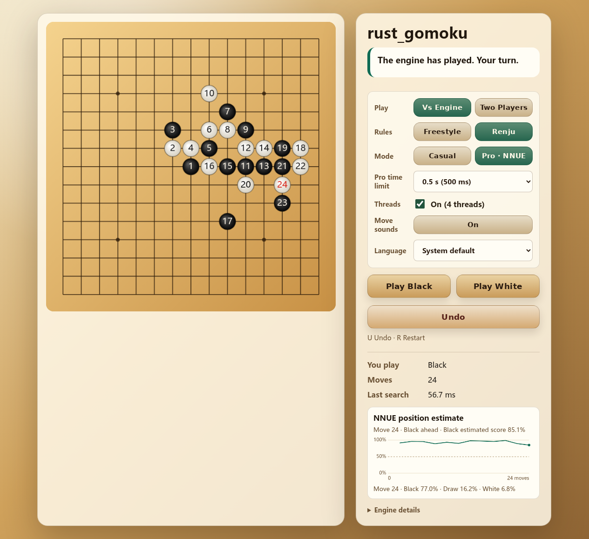
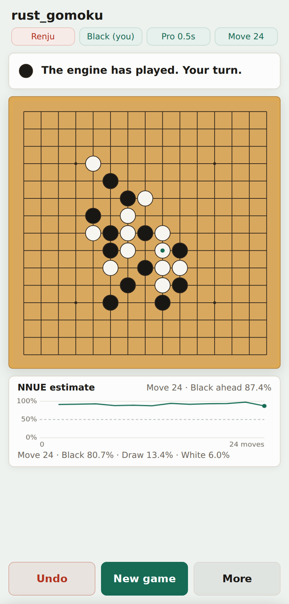
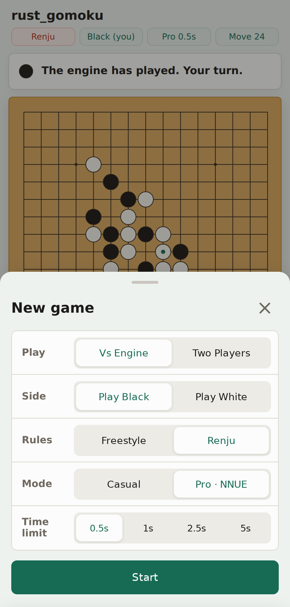

# rust_gomoku

`rust_gomoku` is a 15×15 Gomoku engine written in Rust, built for strong play under practical time controls. It supports **Freestyle** and **Renju** and powers a desktop browser interface, an Android app, and a Gomocup engine.

[简体中文](README-cn.md) · [Latest release](https://github.com/chubbyk-uu/rust-gomoku/releases/latest) · [Documentation](docs/README.md)

## Download and play

| Platform | How to start |
|---|---|
| Windows x64 | Extract the release ZIP and run `gomoku_gui.exe`. It opens the game in your browser. Keep the bundled `nnue/` directory next to the executable for Pro mode. |
| Android ARM64 | Install the signed APK from the release page. It includes the weights for both rules. An AAB is provided for distribution. |
| Linux or Gomocup | Build from source and run the desktop interface or the `gomocup_engine` command below. |

The desktop and Android interfaces support engine play and local two-player games. In Renju, the board marks forbidden moves for Black and rejects them as input.

The interface follows the system language by default, using Simplified Chinese for Chinese locales and English for other locales. Choose **Language** in the desktop settings or under **More** on Android to override it.

| Mode | What it uses |
|---|---|
| **Pro** | Native `Mix9svq` NNUE and a per-move budget of **1 second** by default. Also supports 0.5, 2.5, and 5 seconds, a multithreaded search toggle, and a win-rate estimate chart. |
| **Casual** | Classical fixed-depth search at Beginner, Normal, Senior, or Master. It runs without NNUE weights. |

## Screenshots

**Desktop · Renju in Pro mode.** The right panel shows the NNUE win-rate estimate and the last move's search time.



**Android · Game and new-game settings.** These are browser captures of the Android interface connected to the Rust JNI bridge on the development machine.

<p>
  
  
</p>

[View the English Android landscape layout](docs/screenshots/android-landscape-en.png).

## Engine

The native NNUE engine combines incremental board patterns and evaluation, tactical QVCF, and Lazy SMP. Inference uses AVX2 or AVX-VNNI on supported x86-64 CPUs, and NEON with dot-product acceleration where available on ARM64.

Freestyle uses one set of Mix9svq weights for both colors. Renju loads separate Black and White networks. The project uses compatible Rapfi weights. See the [engine guide](docs/engine.md#nnue-weights) for filenames, search paths, and classical presets.

## Build from source

```bash
cargo build --release --locked
cargo test --locked
cargo run --release --bin gomoku_gui
```

The desktop interface opens at `http://127.0.0.1:18080`. To specify a weight directory, run `cargo run --release --bin gomoku_gui -- --nnue-dir /path/to/weights`.

### Use the Gomocup engine

```bash
printf 'START 15\nINFO rule 4\nINFO timeout_turn 1000\nBEGIN\nEND\n' | \
  target/release/gomocup_engine --nnue-dir /path/to/weights --threads 4
```

`INFO rule 4` selects Renju. Use `INFO rule 0` for Freestyle. Gomocup uses classical search when no weight directory is configured. The [protocol guide](docs/gomocup.md) covers clocks, memory, fixed-depth runs, and diagnostics. Build and signing instructions for Android are in the [Android guide](docs/android-app-design.md).

## Playing strength

The engine build tested for `v0.1.21` scored **50.92%** over 600 games against Rapfi at one second per move. Both engines used the same weights and thread counts, and each opening was played in both colors. Scores count draws as half a point.

| Matchup | Games | W–L–D | Score |
|---|---:|---:|---:|
| Freestyle 1T | 100 | 39–40–21 | 49.50% |
| Freestyle 4T | 100 | 43–34–23 | 54.50% |
| Renju 1T | 200 | 85–84–31 | 50.25% |
| Renju 4T | 200 | 82–80–38 | 50.50% |

The combined 95% interval was **49.25%–52.58%**. A second run of the same Renju 1T matchup scored **53.00%**, for **51.63%** over the two runs. See the [match log](docs/perf-log.md) for the settings, timings, and paired comparisons.

## Development

Start with the [testing guide](docs/testing.md) for match commands, rule fixtures, and fixed-position regressions. The [documentation index](docs/README.md) links to the engine, Renju rules, and [current roadmap](docs/optimization-roadmap.md).

## License

[GPL-3.0-or-later](LICENSE). Network weights are separate assets with their own licensing.
