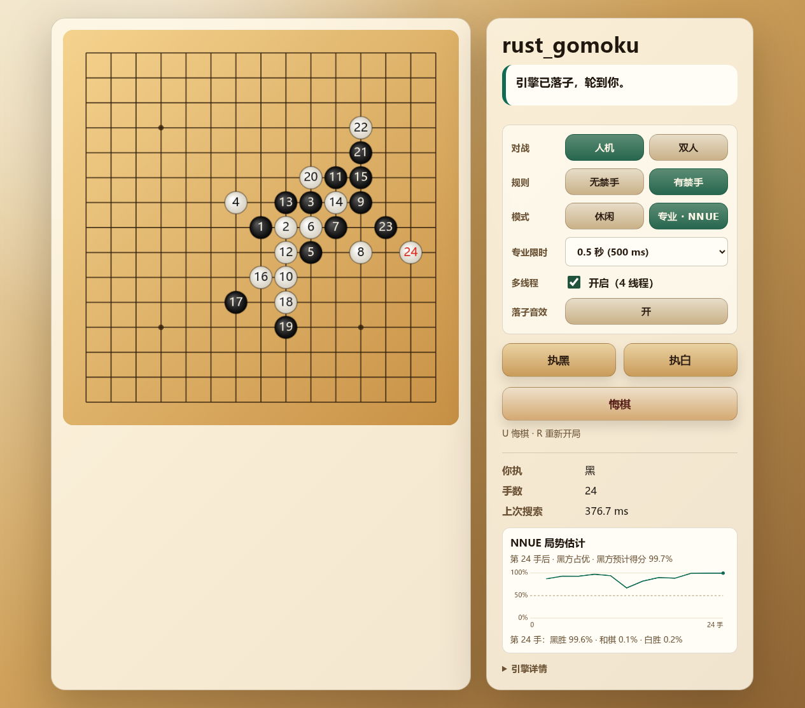
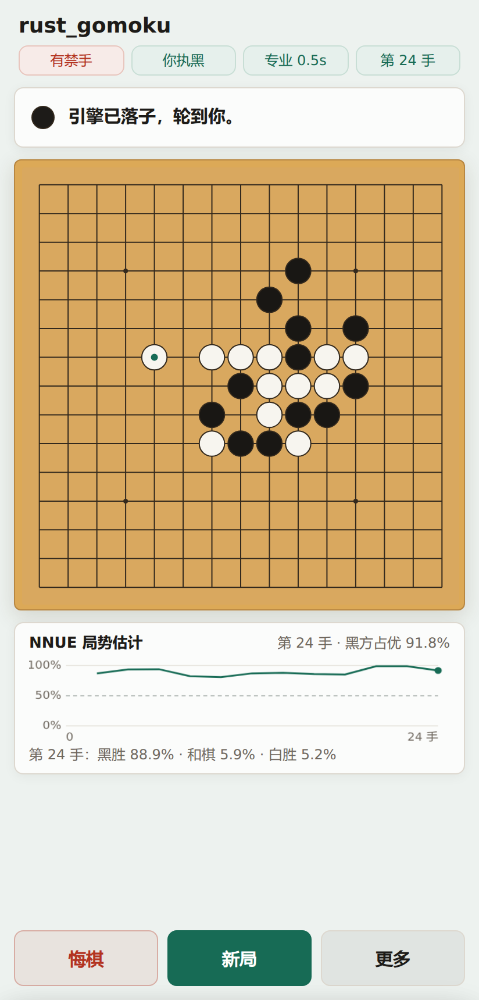
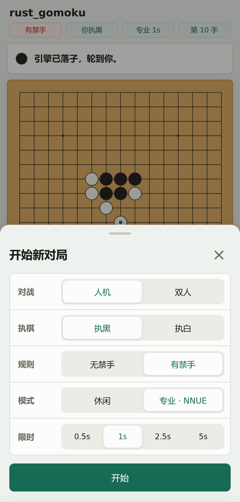

# rust_gomoku

`rust_gomoku` is a high-strength 15×15 Gomoku engine written in Rust. It supports Freestyle and Renju and is developed for strong play under practical time controls, reliable rule enforcement, and low search latency.

[简体中文](README-cn.md) · [Downloads](https://github.com/chubbyk-uu/rust-gomoku/releases/latest) · [Documentation](docs/README.md)

- **Search** — native `Mix9svq` NNUE with SIMD acceleration, incremental board evaluation, tactical search, and Lazy SMP. Classical search supports play without network weights and the Casual difficulty presets.
- **Play** — desktop browser UI and Android ARM64 app, with engine play and local two-player games. Pro mode offers a live NNUE win-rate estimate and selectable time per move.
- **Integrate** — the `gomocup_engine` executable uses the Gomocup stdin/stdout protocol.

## Play

Download the Windows x64 build or the Android ARM64 APK from [GitHub Releases](https://github.com/chubbyk-uu/rust-gomoku/releases/latest). Android AABs are also provided for distribution.



<p>
  
  
</p>

[Android landscape view](docs/screenshots/android-landscape.png)

Pro mode defaults to 1 second per move and also offers 0.5, 2.5, and 5 seconds. Casual mode offers Beginner, Normal, Senior, and Master. The UI marks and rejects forbidden black moves in Renju. See the [rules guide](docs/renju-forbidden-design.md) for supported rules and opening options.

## Build and run

```bash
cargo build --release --locked
cargo test --locked
cargo run --release --bin gomoku_gui
```

The desktop GUI opens `http://127.0.0.1:18080`. Use `-- --nnue-dir /path/to/weights` to load Pro weights explicitly. See the [engine guide](docs/engine.md#nnue-weights) for filenames and discovery order.

Run the Gomocup engine with NNUE:

```bash
target/release/gomocup_engine --nnue-dir /path/to/weights
```

For protocol options and a smoke test, see the [Gomocup guide](docs/gomocup.md). For Android builds and signing, see the [Android guide](docs/android-app-design.md).

## Playing strength

In the 2026-11-28 development build, a same-weight, 1-second-per-move match against Rapfi scored **50.92% over 600 games** across both rules and 1T/4T. The 95% interval was **49.25%–52.58%**. See the [results and reproducibility notes](docs/perf-log.md) for the individual matchups and Renju 1T repeat.

See [testing](docs/testing.md) for regression checks and match commands, and the [roadmap](docs/optimization-roadmap.md) for current development priorities.

## License

[GPL-3.0-or-later](LICENSE). Network weights are separate assets with their own licensing.
