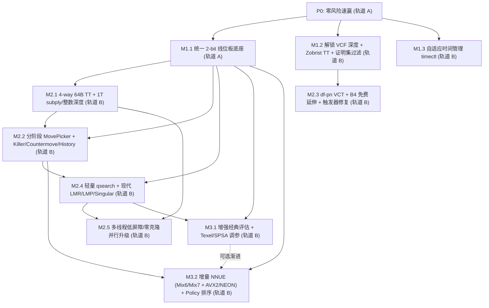

# Performance & Playing-Strength Optimization Roadmap

> 本文档制定 `rust_gomoku` 面向高性能与高棋力的中长期演进路线图。设计结合了当前代码剖析、[docs/perf-log.md](perf-log.md) 的历史实证结论，以及现代顶尖 CPU 五子棋/连珠引擎 **Rapfi** 的核心架构思想。
>
> 适用基准：`master` @ `v0.1.16`（`7fafe74`），后续每个里程碑落地后均按 [AGENTS.md](../AGENTS.md) 在 [docs/perf-log.md](perf-log.md) 记录实测数据并更新本清单状态。

---

## 1. 总体原则与可行性边界

### 1.1 为什么不能只照搬 Rapfi 的上层剪枝

[docs/perf-log.md](perf-log.md) 已多次验证：在现有 92 桶线性评估 + 无动态排序 + 无树内战术安全网（`qsearch` / 树内 VCF）的前提下，直接叠加激进前向裁剪（浅层 RFP、Futility、Quiet LMR、Aspiration Window）几乎必然漏算反杀或拖慢长尾。

Rapfi 的高 NPS 与高棋力来自**四层强耦合设计**：
1. **统一增量位板底座**：全局仅维护一套 2-bit 线位板与增量 `Pattern4`，评估、着法生成、禁手判定、战术搜索零重建复用。
2. **高效率走法排序与置换表**：4-way 64B 对齐 TT + 预取 + 分阶段 `MovePicker`（TT move 零 movegen 直接搜）+ Killer/Countermove/History。
3. **深层战术与现代搜索**：深层 Zobrist-TT VCF、`df-pn` VCT、叶节点 `qsearch` 安全网、整数/定点数深度、对数 LMR 与自适应 `timectl`。
4. **高精度增量评估**：从多方向/攻防交互/分规则经典评估，演进至基于 `Pattern` 码本的增量 NNUE（Mixnet）+ Policy 排序。

因此本路线图坚持 **“先底座、再战术与排序、再搜索与时间管理、最后评估跃升”** 的递进顺序。

### 1.2 双轨治理（遵循 `AGENTS.md`）

- **轨道 A（`base` 行为等价纯提速）**：固定局面下 move / score / nodes / tactical trace 与当前 `master` 保持一致（或仅为已证明的正确性修复）；通过 `13/13` reference diff 后可直接合入 `master`。
- **轨道 B（实验分支棋力/性能突破）**：允许改变搜索行为与评估，必须在独立实验分支开发，保留可回退路径；合入或设为推荐配置前，必须以当前 `master` 为基线完成实盘对弈验证（得分率 $\ge 50\%$，0 错误、0 超时，且具备明确的 Elo 或 avg/p95/max 耗时收益）。

### 1.3 可行性实话实说

- **P0、P1、P2 及 P3 路线 1（增强经典评估 + Texel/SPSA 自动调参）**：全部为纯 Rust 工程 + 本机 CPU 可闭环验证，**100% 可在本仓库内独立完成**。
- **P3 路线 2（Rapfi 风格增量 NNUE / Mix6–Mix7）**：
  - 推理侧（Rust 增量累加器 + AVX2 / ARM64 NEON SIMD + Policy 排序 + 权重加载 + 经典评估回退）**100% 可独立实现**。
  - 训练侧需要模型权重与训练算力支持（GPU 自对弈/强引擎对局数据蒸馏，或合规引入轻量训练管线）。若暂无 GPU 集群，可先落 P3 路线 1，再逐步建设轻量蒸馏训练链路。

---

## 2. 阶段依赖关系总览

---

## 3. 统一验证与止损矩阵

除明确豁免的纯文档提交外，每个里程碑必须跑完对应门禁：

| 检查项 | 轨道 A (`base`) | 轨道 B (实验分支) | 命令 / 基准集 |
|---|---|---|---|
| 格式与编译 | 必须 | 必须 | `cargo fmt --check && git diff --check && cargo build --release --bins` |
| 单元与桥接测试 | 必须 | 必须 | `cargo test` + `android/rust_bridge` 测试 + Renju oracle 回归 |
| Reference Diff | **13/13 必过且节点一致** | 核对无意外规则退化 | `python3 scripts/run_diff.py --profile all --check-baselines --jobs 8` |
| 固定慢手 & 战术基准 | 必测 A/B | 必测 A/B | 5 慢手 (`c43_p32`, `c25_p68`, `c21_p145`, `c34_p154`, `c34_p83`) + `vct_dense_ply78` / `vct_counter_win_scan_ply75` / `vct_slow_probe_case` + `renju_search_bench` |
| 实盘对局验证 | 可选抽测 | **必测（vs 当前 `master`）** | `cases/renju/center_50_prefixes.jsonl` 100 局 Renju（d8/w40 与 1s/3s 限时）；推荐配置前扩至 200 局 + Freestyle 100 局 + SlowRenju/Rapfi 外部参照 |
| 合并门槛 | 净加速 > 噪声且行为 100% 等价 | 得分率 $\ge 50\%$、0 错误、0 超时、avg/p95/max 或 Elo 显著正向 | 所有数据回填 `docs/perf-log.md` |

---

## 4. 分阶段详细计划

### 阶段 P0：零风险速赢（轨道 A · 行为等价）

目标：在不改动任何搜索语义的前提下，立刻清理已定位的内存/原子/克隆浪费，把 `master` 基线再提速 `10%–20%`。

#### M0.1 瘦身 `EvalSnapshot` 与移除 release 死字段
- **现状问题**：`src/eval/caches.rs` 的 `EvalSnapshot` 每次 snapshot/restore 拷贝约 `1.16 KiB × 2`，其中 `occupied_moves: [Move; 225]`（`450 B`，占 39%）在 release 构建下从未被读取（仅用于 `#[cfg(debug_assertions)]` 的 `evaluate_dgn_from_occupied`）。
- **改造内容**：
  1. 将 `occupied_moves` / `occupied_len` 仅保留在 `#[cfg(debug_assertions)]` 下，或直接删除（`dgn_sum` 已增量维护）。
  2. 评估将 `board_shadow` (225B) 与 `empty_bucket_counts` (368B) 改为对称 `make/unmake`（或紧凑定长增量 delta），消灭大块 `memcpy`。
- **净收益假设**：每节点减少 `900B–2.1KiB` 内存拷贝与维护分支，新增成本近乎为零。
- **止损条件**：5 慢手总耗时净加速 `< 3%` 时只保留去死字段部分，不引入复杂 delta 日志。

#### M0.2 修复 TT `probe()` 瑕疵、消除每节点 `Acquire` load 与增加 Prefetch
- **现状问题**：
  - `src/search/tt.rs` 每次 `probe`/`store` 都在 `buckets_for_mode()` 执行一次 `primary_mode.load(Ordering::Acquire)`。
  - `probe()` 命中 slot 0 且仅收窄窗口（`has_window: true`）时直接 return，跳过检查 slot 1；slot 1 若同 key 且 `best_move == None` 会覆盖 slot 0 的有效 `Some(mv)`。
  - 全仓无 TT 桶软件预取（prefetch）。
- **改造内容**：
  1. 在 `AlphaBetaSearcher` 单次搜索入口一次性获取当前模式的 `&[TTBucket]` 切片引用，消除热路径 `Acquire` 原子读。
  2. 在 `make` 落子计算完子局面 `zobrist_key` 后，对目标 TT 桶发起 `prefetch`（x86 `_mm_prefetch` / ARM `prfm` 兼容封装）。
  3. 单独验证修复 `probe()` slot 1 跳过与 `fallback_best_move` 覆写（注意先检查是否改变 13/13 diff；若改变节点数，移入 M2.1 实验分支）。
- **净收益假设**：减少原子屏障与 L3/DRAM 缓存缺失停顿；无额外内存占用。
- **止损条件**：若 prefetch 在 32 MiB/64 MiB 实测未带来正向增益（`< 1%`），则不保留无用汇编封装。

#### M0.3 共享只读 `Arc<EngineConfig>` 消除多线程每层克隆
- **现状问题**：`src/search/root.rs` 与 `src/search/abdada.rs` 在每个 `depth >= 5` 迭代层中，主线程 + 每个 worker 反复 clone 整个 `EngineConfig`（含 4 个 `Vec<f64>` 堆分配）与完整 `EvalCaches`。
- **改造内容**：将 `EngineConfig` 内的只读表改为 `Arc`，持久化 worker 本地 `Board`/`EvalCaches` 复用缓冲区，仅在开局或局面变更时同步差量。
- **止损条件**：`4T`/`8T` 中盘及浅层 d5–d8 启动开销应可测下降，且 `1T` 零回归。

---

### 阶段 P1：底层统一、深层战术与时间管理（轨道 A + B）

目标：打通 `Pattern4` 统一底座，补齐当前最明显的战术短板（VCF 暗截断、暴力防 VCF 过滤）和实战短板（原始时间管理）。

#### M1.1 统一 88 线 2-bit 位板底座（`Eval` / `Threat` / `Forbidden`）【轨道 A 优先】
- **现状问题**：
  - `src/eval/local.rs` 仍是 Alpha-Beta 第一热点（`~33.5%` CPU），每步落子现场扫 60 格拼 `PackedLine`。
  - `src/threats/threat_board.rs` 仍并行维护旧 `x1..x4: Vec<Vec<i32>>` 和部分旧线扫描。
  - `src/rules/forbidden.rs` 每次判定拷贝 225B `grid` + 重建 4 条 `DirectionalLine`。
- **Rapfi 对标**：全引擎常驻一套 2-bit 线位板，落子仅翻 4 个 bit-pair，所有模块共享增量状态。
- **改造内容**：
  1. 在 `EvalCaches`（或统一 `BoardState`）常驻 88 条 2-bit `u64` 线位板，替代 `PackedLine::from_board` 现场扫盘，保持 `SHAPE_TABLE` 输出 100% 位等价。
  2. 彻底清理 `ThreatBoardView` 中遗留的 `x1..x4` 堆数组与旧线扫描，全部收口到 `Pattern4State`。
  3. 改造 `rules/forbidden.rs` 直接在 2-bit 线位板上做四/活三判定（先保留原实现作随机 oracle 对拍，2000+ 局 0 差异后切换）。
- **预期收益**：单线程 NPS 再提 **20%–35%**，Renju 单节点开销显著逼近 Freestyle，同时消除进 VCF/VCT 时的重建开销。
- **止损条件**：等价模式下 13/13 diff 必须全过，5 慢手总耗时净加速需 $\ge 10\%$。

#### M1.2 解锁 VCF 深度上限 + 定长 Zobrist TT + 证明集过滤【轨道 B】
- **现状问题**：
  - `src/threats/vcf.rs` 的 `VCFM = 5` 把配置的 `root_vcf_depth = 8` 暗中截成 **5 步**、`opponent_vcf_depth = 7` 截成 **4 步**。
  - VCF memo 使用 `HashMap<(Side, Vec<Move>, Vec<Move>), ...>` 每次分配+排序。
  - `root.rs::apply_opponent_vcf_filter` 对全盘最多 225 格逐一克隆 `Board` 并重建 `Pattern4State` 跑完整 VCF。
- **改造内容**：
  1. 用基于 Zobrist `u64` 的定长轻量 VCF TT（如 64K–256K 槽 + generation 清空）替代 `HashMap<Vec>`。
  2. 移除 `VCFM = 5` 硬截断，支持根节点 VCF 搜到 **14–20 ply**（配安全节点上限，例如 50K–200K 节点，防止极端无解局耗时失控），并确保 `opponent_vcf_depth` 真实生效。
  3. `apply_opponent_vcf_filter` 改为收集对手 VCF 证明树的相关格集合（攻击点 + 冲四防点 + 关联阻断点 + 己方反冲四/成五点），仅对该子集复用单个 `ThreatBoardView` 做 `play/undo` 试探。
- **预期收益**：6–20 步实战长冲四杀从完全盲区变为毫秒级必杀；对手 VCF 过滤提速 **10x+**。
- **止损条件**：100 局 Renju/Freestyle 对局零误判、得分率 $\ge 50\%$，且 VCF 耗时不拖累 avg/p95。

#### M1.3 现代自适应时间管理 `timectl`【轨道 B】
- **现状问题**：`src/protocol/gomocup.rs` 直接取 `min(timeout_turn, time_left)`，在仅下发局时（`timeout_match` / `time_left`）时会把整盘剩余时间全砸在一步；迭代加深无软/硬时限分离、无稳定性早停，经常开启注定超时的新一层并整层丢弃结果。
- **Rapfi 对标**：`timectl` 根据剩余局时与当前步数动态计算 `optimum_time`（软）和 `maximum_time`（硬），结合最佳走法稳定性、分数骤降（fail-low 延长）、唯一迫着秒下、EBF 预测避免启动无效末层。
- **改造内容**：
  1. 实现 `TimeManager`：支持 `turn_time` + `match_time` 综合分配（如按局势阶段估算剩余步数 `expected_moves_left`，留足安全余量 `move_overhead`）。
  2. 引入软/硬双限：每层结束检查 `elapsed >= optimum_time` 或 EBF 预测下一层超时即提前退出；出现 `best_move` 切换或大幅掉分时动态放宽至 `maximum_time`；唯一着/必胜着直接早停。
  3. 允许在严格安全条件下保留已验证更优的末层结果（仅当至少完成首选着且发现经完整窗口验证的严格改善，避免半成品污染）。
  4. 限时模式下根据局面战术密度动态分配 VCT 子预算，替代写死 30%。
- **预期收益**：Gomocup 局时赛与 1s–5s 快棋 **+50~120 Elo**，且不发生超时判负。
- **止损条件**：限时 100 局对弈超时率必须为 `0%`，相比旧限时策略需显著净胜。

---

### 阶段 P2：搜索算法、VCT 与并行架构现代化（轨道 B）

目标：彻底解决固定深度长尾爆炸、排序质量差、单活三 VCT 盲区和水平线漏杀，同等时间多看 **2–4 ply**。

#### M2.1 4-way 64B 对齐 TT + 1T `subply` / 整数深度 + 停写叶节点
- **现状问题**：
  - 1T 模式下 `floor` 写 / `ceil` 查导致小数深度同层 TT 截断大面积失效。
  - 2-way 32B 桶未对齐 64B cache line（多线程相邻桶伪共享），无同 key 去重，`generation` 未参与替换，纯叶节点全部写入 TT 冲刷 slot 1。
  - `src/zobrist.rs` 写死 `turn: 0` 且依赖平台 libc `rand()`。
- **改造内容**：
  1. 将 `Zobrist` 切换为跨平台确定性 PRNG（如 SplitMix64）并支持 `side_to_move` XOR（保留 `base` 兼容模式开关或随实验分支一并切换）。
  2. 升级 TT 为 **64B 对齐 4-way 桶**（4 × 16B 或紧凑 12B/16B 槽），实现 **同 key 覆盖 + 世代老化 + 深度优先**替换策略。
  3. 停止将纯静态叶节点（`depth <= 0`）写入 TT。
  4. 评估并统一 1T 与 MT 的深度表示（短期 1T 启用 1/64-ply `subply_tt`；随 M2.4 彻底转向整数/定点深度）。
- **预期收益**：1T 长尾节点数预计下降 **20%–50%**，多线程 TT 缓存行争用显著缓解。

#### M2.2 分阶段 `MovePicker` + Killer / Countermove / History
- **现状问题**：
  - 当前每次进节点哪怕 `tt_best_move` 首位就能截断，也要全量扫 225 格覆盖区、算完所有空位分值并堆分配 `Vec<Candidate>`（占中盘 CPU ~21%）。
  - `hsflag` 仅保留单个对手活三，多活三漏防；`single_forcing` 存在多个迫着时粗暴坍缩为 1 点。
  - 无动态排序启发，`fast_trunc` 造成大量平局团。
- **Rapfi 对标**：Stockfish 式栈上分阶段 `MovePicker`（`TT_MOVE -> FORCING_THREATS -> QUIET_ORDERED`）。
- **改造内容**：
  1. **Stage 0 (`TT_MOVE`)**：只做 `O(1)` 合法性校验，直接搜 TT 走法；截断则彻底跳过 movegen 与排序。
  2. **Stage 1 (`FORCING` / `TACTICAL`)**：直接从 `Pattern4` 位板提取成五、活四、冲四、对手活三全部防点（修复多活三漏防和 `single_forcing` 误坍缩）。
  3. **Stage 2 (`QUIET`)**：在栈数组（`[ScoredMove; 225]`，零堆分配）生成其余覆盖候选，融合静态攻防分 + **2-slot Killer + Countermove + Butterfly/Continuation History**，使用懒局部选择排序（每次只挑下一个最高分，不排尾部），移除 `fast_trunc` 精度截断。
- **注意历史教训**：严禁重蹈旧 `fast_history_ordering` 覆辙（它在全节点 eager 计算 `getmi` + 全量排序导致慢 29.5%）；新排序必须严格遵循“TT 先截断 + 懒局部选排 + 零 `getmi` 依赖”。
- **预期收益**：减少 40%–60% 内部节点 movegen，大幅提高首着截断率与降低 PVS 重搜率。

#### M2.3 VCT 升级为 `df-pn` + B4 免费延伸 + 修复单活三触发盲区
- **现状问题**：
  - 朴素 IDDFS VCT（`root_vct_depth = 6`）对宽分支爆炸、对窄长分支看不深；B4 单防点与 A3 同等扣深，叶节点不接 VCF。
  - `has_vct_trigger_for_rule` 在无冲四且不能一步双活三时（含 Renju 黑方禁 3-3）直接跳过 VCT，漏算单活三起手杀。
- **改造内容**（对应 `perf-log.md` Route C）：
  1. 先做增量增强：B4 单防点不耗（或低耗）A3 深度、VCT 叶节点接快速 VCF、扩展触发器覆盖单活三可续攻局面（配节点上限）。
  2. 核心升级：实现基于 `Pattern4State` + 固定大小 Zobrist TT 的 **`df-pn`（Proof/Disproof Number Search）** VCT 求解器，支持节点/时间预算无缝退出，并完整保留 Renju A3 静点反驳与黑方禁手验证（0 误判回归）。
  3. 解决不限时模式 VCT 无上限风险：评估合理的高节点上限（如 500K–2M 节点）确保既能算透 12–20 步杀棋又不出现极端卡死。
- **预期收益**：中后盘算杀深度从 6 步跃升至 12–20 步（预计 **+50~100+ Elo**），同时大幅压缩高密度残局 VCT 长尾。

#### M2.4 轻量 `qsearch` + 现代搜索框架（对数 LMR / LMP / IIR / Singular）
- **现状问题**：
  - `depth <= 0` 无 `qsearch`，靠 `global_eval.rs` 里低效的 `LAST5`/`NEXT43` 补丁，导致水平线漏杀，也使 RFP/Futility/LMR 无法安全开启。
  - `running_downf` 进位 LMR 存在 $O(k^2)$ 粗暴减层、余数传子节点破坏 PV、漏杀不重搜等结构缺陷。
  - `extend_ratio = 0.9` 无 `ply` 上限 + `wide = 40` 全树不衰减制造长尾。
- **改造内容**（**严格逐项消融，每开一项必须跑 100 局实盘对弈验证**）：
  1. **轻量 `qsearch`**：基于 `Pattern4` 位板在 `depth <= 0` 仅搜索迫着（成五/活四/冲四及必防，限深 6–10 ply），替换 `LAST5`/`NEXT43` 全盘扫描。
  2. **转向整数/定点深度 + 对数 LMR 表**：替代 `running_downf`；`R = lmr_table[depth][move_idx]`，按 `is_pv`、`improving`、`is_forcing`、`history` 调整，绝不跨层传余数，fail-high 始终全深重搜。
  3. **有上限的迫着延伸 + LMP**：用「单防/威胁延伸 + `ply` 上限」替代无上限 `extend_ratio = 0.9`；浅层安静着引入 LMP 替代全树固定 `wide = 40`。
  4. **按需验证 IIR / RFP / Futility / Singular Extension**：只在有 `qsearch` 和校准评估后逐项测试，不达标即回退。
- **预期收益**：消除系统性漏杀与 15s–70s 极端长尾，同等时间内有效搜索深度提升 **+2 ~ +4 ply**。

#### M2.5 多线程并行升级（去强屏障 + 多样化探索 + VCT 并行）
- **现状问题**：每层主线程阻塞等全部 worker、PV 首着前全员重复搜 #0、8T 扩展率停留在 `~2.2x–2.4x`、`overlap_vct_alphabeta` 同步拷贝整张 TT 且新建线程池。
- **改造内容**：
  1. 在 M2.1 + M2.2 + M2.4 基础上，试验 **异步迭代 / 错峰深度 + 轻量 ABDADA 避碰**，去除每层强制等待屏障，并允许 worker 在 PV 尚未稳定时探索不同候选/深度。
  2. 若 `df-pn` VCT 落地，支持共享 VCT TT 的多线程并行算杀，并让 `overlap_vct_alphabeta` 复用现有线程池、彻底移除整张 64 MiB TT 拷贝。
- **预期收益**：4T 进一步提速，8T 扩展率向 **4x–5x+** 逼近。

---

### 阶段 P3：评估函数代际跃升（打破棋力天花板 · 轨道 B）

> 搜索和战术优化到位后，棋力的最终决定因素是评估精度。提供两条递进路线，可先落 M3.1，再冲刺 M3.2。

#### M3.1 路线 1：增强经典评估（4 方向 + 攻防交叉 + 分规则）+ Texel/SPSA 自动调参
- **现状问题**：`default_eval_para.txt` 仅有 92 个双方向线性桶（丢弃第 3/4 方向）、零攻防交叉项、无阶段/位置/连接特征、Freestyle 与 Renju 共用一套 `f64` 权重。
- **改造内容**：
  1. 评估全面改为 `i32` 定点整数运算，消除热路径 `f64` 转换。
  2. 复用统一 `Pattern4` 扩展特征：完整 4 方向组合、同点攻防交互表（`self_pat × opp_pat`）、开中残局阶段插值（Tapered Eval）、中心/连通/先手 Tempo 项。
  3. 为 **Freestyle** 与 **Renju** 分别建立独立参数表。
  4. 在 `tools/` 下编写自对弈数据采集 + **Texel Tuning / SPSA** 参数优化器（纯 CPU 即可运行）。
- **预期收益**：评估更快且质量显著跃升，保守 **+100~200 Elo**。

#### M3.2 路线 2（终极目标）：Rapfi 风格增量 NNUE（Mix6 / Mix7 + AVX2 & ARM64 NEON）+ Policy 排序
- **Rapfi 对标（arXiv:2503.13178）**：
  - 输入为 4 方向长度 11 的 1D 棋型码本（直接复用本项目 `Pattern4` 的 88 条 2-bit 线位板）。
  - 轻量 **Mixnet**（`Mix6` / `Mix7` 级，INT8/INT16 量化权重仅 **0.5 MB – 3 MB**，适合内嵌桌面端与 Android APK/AAB）：码本映射 → 局部 3×3 深度可分离卷积 / 通道混合 → 全局累加器 Value Head + 局部 Policy Head。
  - `make/unmake` 时仅增量更新落子 4 轴 ±5 格影响区域的特征累加器。
- **改造内容**：
  1. 设计抽象 `Evaluator` trait（`ClassicalEval` 与 `NnueEval` 可热切换、支持无缝回退）。
  2. 实现增量 NNUE 累加器与 SIMD 推理后端：
     - x86_64：`AVX2`（可选 `AVX-VNNI`），带运行时特性检测与标量回退。
     - Android / ARM64：`NEON`（可选 `dotprod`），兼顾移动端低功耗与高 NPS。
  3. 将 NNUE 输出的轻量 **Policy 分数**接入 M2.2 的 `MovePicker`，取代静态启发式排序。
  4. 配套外部 PyTorch 训练/量化导出脚本（支持自对弈或强引擎对局蒸馏，Freestyle / Renju 各自导出紧凑二进制权重文件）。
- **预期收益**：跨代棋力飞跃（保守 **+400~800+ Elo**），同时 Policy 排序大幅压缩 Alpha-Beta 分支因子，使现代前向裁剪收益最大化。

---

## 5. 已知禁区与防回退清单（来自 `docs/perf-log.md`）

以下方向已被历史实验证伪或证明存在严格前提，**除非前提发生根本改变，否则不得重复投入**：

1. **盲目扩大默认 TT 到 128 MiB**：L3/TLB 抖动导致正常中盘与部分长尾变慢（`+6% ~ +28%`）；默认保持 1–3T `32 MiB` / 4+T `64 MiB`，扩大前必须证明 4-way/对齐后缓存局部性已改善。
2. **在无 `qsearch` 与旧线性评估下直接加 RFP / Futility / Quiet LMR**：已实测掉棋力（`47.5%`, `-17.4 Elo`）甚至反拖慢 max 耗时（`36s -> 82s`）。必须放在 **M2.4（`qsearch` + 新排序就绪后）** 再逐项消融验证。
3. **直接截断 `extend_ratio` 而不补强战术安全网**：曾使 100 局胜率暴跌至 `38.5%`（`-81.4 Elo`）。
4. **破坏懒排序的 Eager History 排序**：旧 `fast_history_ordering` 因每节点全量 `getmi` + 全排序变慢 `+29.5%`；新 History 必须依附分阶段 `MovePicker`。
5. **非重点微优化**：`recompute_all` 复用、VCF memo key 微调（非热点）、`ThreatBoardView` 在 `play()` 上做全量额外 bitset 维护、旧式 root YBWC / root full-window split / 无保护 Aspiration Window。
6. **在 `1T` 与 `MT` 共享 TT 或 `subply` 量化上破坏 soundness**：严守 `store = floor`、`probe = ceil`、超上限深搜退化为仅 move-hint、1T/MT 模式隔离等全部回归测试。
7. **纯单步限时禁用软早停与过大 overhead 扣减**（2026-11-22 实测教训）：在无局时结余的纯 `timeout_turn` 模式下，提前早停省下的时间无法结转，反而损失 TT 预热（`1s/move` 掉至 `44.0%`）；软早停仅限局时赛（`timeout_match` / 紧张 `time_left`）。
8. **严禁在 `running_downf` 跨层余数未消除前单独对 1T 开高命中率 `subply_tt` 期待固定 `d8` 涨分**（2026-11-22 实测教训）：`M2.1 v2` 在限时 `1s/move` 下大赢（`54.5%`, `+31.4 Elo`, 中位快 `4.46x`），但在固定 `d8/w40` 下因跨路径 `downf` 污染 TT 仅得 `44.5%`；且同 key TT 更新绝不允许 `depth = 0` 叶节点或浅条目覆写更深条目。
9. **宽树 (`wide = 40`) 下 LMR 强度不得弱于原 `running_downf`，且 VCT 叶节点不得嵌套递归 VCF、不得用单活三弱触发吃掉限时预算**（2026-11-22 实测教训）：过温和对数 LMR 令节点暴涨 `5.1x`（`39.5%`）；VCT 叶节点嵌 6 步 VCF 令密盘 VCT6 从 `166ms` 暴涨至 `>120s`；单活三弱触发令 `1s/move` 掉至 `46.5%`。

---

## 6. 执行追踪清单（按限时不限时双赢优先级排序）

- [x] **P0 — 零风险速赢 (`base`，已合入 `master` `7a30f07`)**
  - [x] `M0.1` 瘦身 `EvalSnapshot`（去除 release 死字段 `occupied_moves`，`board_shadow` 改增量日志，紧凑化 undo log）
  - [x] `M0.2` 消除 TT 热路径 `Acquire` load（`TTTableView`）+ 增加 x86_64 TT `prefetch`
  - [x] `M0.3` `Arc<EngineConfig>` 与持久化 `WorkerLocal` 复用 `EvalCaches` / `AlphaBetaSearcher`，消除多线程每层克隆
- [x] **`M1.1` — 底层位板统一 (`base`，已合入 `master` `7a30f07`)**
  - [x] 88 线常驻 `PackedLine` 位板 + 跳过非空邻域格 `SHAPE_TABLE` 查表 + 清理 `ThreatBoardView` 遗留 `x1..x4` 堆数组
- [x] **阶段 1（已评估并回退）：`M2.2a` Stage 0 `TT Move` 零 movegen 快速通道**
  - [x] 已在 `center_50_prefixes` 100 局 `1s/move` 实测（`48-50-2`, `49.0%`）；因中盘几乎总存在至少一个 `L4`/`L5` 格导致 `!has_high_threat_bucket()` 拦截 ~90% 节点，无净收益已回退；待 `M2.4` + 栈上分阶段 `MovePicker` 阶段再重做
- [x] **阶段 2（已合入 `master` 并完成审阅加固）：`M2.3` `df-pn` VCT 求解器**
  - [x] 实现 2-way 3 MiB Zobrist TT + 深度加权 proof-number + 本地子节点 `(pn, dn)` 缓存的 `df-pn` 求解器，支持 `vct_use_dfpn` 回退开关；`vct_dense_ply78` 提速 `3.31x`（`165.1ms -> 49.8ms`），`vct_counter_win_scan_ply75` 提速 `2.63x`（`336.8ms -> 128.3ms`），`case17` `7.69ms` 证出真胜手且零误判；`run_diff.py` 13/13 全通过；300 局中心开局验证 **Renju 限时 `1s/move` `52-47-1` (`52.5%`, `+17.4 Elo`)**、**Freestyle 限时 `1s/move` `50-48-2` (`51.0%`, `+7.0 Elo`, med `3.16x` 提速)**、**Renju 不限时 `d8/w40` `48-48-4` (`50.0%`, `LD=0, LL=0`, avg `-1.6%`, p95 `-3.6%`)**，全 300 局 0 错误 / 0 超时
- [x] **阶段 3（已完成主体开发与 300 局验收，暂缓合入 `master`）：`M3.2` `Mix9svq` 增量 NNUE（Value + Policy + AVX2 SIMD，`exp/m32-nnue-mix9svq`）**
  - [x] 详细设计与当前缺陷审计见 [docs/nnue-mix9svq-plan.md](nnue-mix9svq-plan.md)
  - [x] 阶段 3.1：纯 Rust LZ4 Frame 解压 + `Mix9svq` 版本栈累加器 + 8 路展开 AVX2 SIMD（`eval_only = 2.83 µs`）+ Rapfi C++ 比特级对齐单测（Freestyle `994` / Renju `80, 225` 完全一致）
  - [x] 阶段 3.2 + 3.3a：接入 `Mix9svq` Value + Policy 排序（保留 `VCF / df-pn VCT / ±WIN` 必杀层 + 默认关闭古典回退开关，`run_diff.py` 13/13 全绿）；300 局 `center_50` 验收 **全 300 局零负对（`LD=0, LL=0`）、0 错误、0 超时**：
    - Renju 限时 `1s/move`：**`79-21-0` (`79.0%`, `+230.2 Elo`, `WW=29, WL=21, LL=0`)**
    - Freestyle 限时 `1s/move`：**`71-28-1` (`71.5%`, `+159.8 Elo`, `WW=21, WD=1, WL=28, LL=0`)**
    - Renju 不限时 `d8/w40`：**`79-18-3` (`80.5%`, `+246.6 Elo`, `WW=29, WD=3, WL=18, LL=0`)**（其中 3 局 225 手满盘和棋 3 线重跑完赛，`nnue` 均耗 `4.21s` vs `master` `5.41s`，但双方单手长尾仍高达 `66–68s`）

---

## 7. 当前全局缺陷与优化优先级清单（2026-11-23 代码级审计 + 防返工复审）

> 在将 `exp/m32-nnue-mix9svq` 合入 `master` 之前，结合 300 局验收、`case22_ply109/114` 单手剖析（`case22_ply114` 单手 9,455 万节点 / 58s）、全仓逐模块审计以及对 `opponent/rapfi/Rapfi/search/ab/search.cpp` 的对照复审，已校正依赖顺序并剔除高返工项，按紧要程度与正确依赖排定 **P0 → P3**：

### 防返工关键前置结论（复审修正）
1. **先 TT（含 `static_eval` 缓存）再 RFP/LMP/Policy-LMR**：Rapfi 实测最大两项剪枝收益为 **RFP（`~121 Elo`）** 与 **LMP（`~107 Elo`）**；但 RFP 必须在内部节点读取 `static_eval`，若 TT 未缓存 `static_eval: i16`，每节点重算 NNUE（`2.83 µs`）会把算力吃掉一半。因此必须把 **4-way 64B TT（含 `static_eval` + `tt_pv`）** 排在 **RFP/LMP/Policy-LMR** 之前一次成型。
2. **不要过早大手术剥离 `EvalCaches`（已从 P1 降级到 P3）**：代码核查 `src/search/movegen.rs` 表明 `EvalCaches` 同时支撑 `attack_level`、Renju 95% 禁手快筛与 `depth < 2` 排序，且叶节点 `evaluate_board_main_cached` 仅耗 `~0.1 µs`（远低于 NNUE `2.83 µs`）；硬拆改动极大、收益仅 ~10%，远不如 3×–10× 剪枝与 `AVX-VNNI` 划算。
3. **提级 `AVX-VNNI` 到 P0 收尾 / P1 前置**：已实测本机 `rustc 1.96.0` 稳定版原生支持 `#[target_feature(enable = "avxvnni")]` + `_mm256_dpbusd_epi32`（运行时检测 `true`），约 100 行代码、100% 标量比特级对齐、零搜索风险，直接给所有后续剪枝实验提速 ~25%–40%。
4. **Policy-LMR / Policy-Pruning 必须用归一化概率（softmax / 相对最大 logit 差）**：`Mix9svq` 原始 policy logit 具平移不变性，绝不能直接拿裸 logit 与常量阈值比较。
5. **双基线消融验收门禁**：所有 P1 搜索剪枝必须逐项消融，且**同时对照 `master`（`8563005`）和 `M3.2`（`9f6b899`）**：先跑 5 秒 `case_probe` 确认 `case22_ply109/114` 节点与耗时大幅下降 → 再跑 40 局 `1s/move` smoke（对 `M3.2` 必须 `> 50%`）→ 最后跑 100 局 `1s/move` + `d8/w40`；且古典 `use_nnue=false` 路径保持 `run_diff.py` 13/13 零回归。

### P0（合入 `master` 前必修 — 正确性/接口缺陷 + 零风险白捡提速，**第一批已完成**）
- [x] **`P0-1` 修复 `RootSearcher` 热更新 `config` 时 NNUE 不重载与静默吞错**
  - 位置：`src/search/root.rs:646`、`src/search/alphabeta.rs:217-223`
  - 修复：统一通过 `AlphaBetaSearcher::sync_config` 检测 `(use_nnue, nnue_dir, rule_set)` 变更并重载；对显式配置的 NNUE 加载失败输出 `eprintln!` 明确告警并补齐热切换单测。
- [x] **`P0-2` 修复 Gomocup `INFO nnue_dir` 带空格路径截断**
  - 位置：`src/protocol/gomocup.rs:122, 288-313`
  - 修复：对 `nnue_dir` 从原始行提取键名后的完整剩余路径（支持去首尾单/双引号与空值清空），并补齐单测。
- [x] **`P0-3` NNUE Policy 懒加载（推迟到 `index == 1`）+ 增量 `sync_with_board`（消除每层全盘重放）**
  - 位置：`src/search/alphabeta.rs:561-590, 754-771`、`src/nnue/mix9svq.rs:1088-1200, 1517, 1697-1790`
  - 修复：
    1. `tt_best_move` 在候选列表内时用 `rotate_right(1)` 置顶并保持剩余候选原扫描序，延迟至 `index == 1` 未截断时再对 `ordered[1..]` 调 `evaluate_policy_moves()`（与旧树 100% 搜索等价）；
    2. 为 `Mix9svqEvaluator` 维护 `synced_history` + `pending_balance` 最长公共前缀（LCP）增量同步，补齐 4 场景比特级对齐单测；
    3. 补齐标量 `evaluate_policy_moves` 仅算候选子集与 `evaluate_policy_avx2` 末层 `policy_dot16_avx2`。
- [x] **`P0-4` 为 `case_probe` 补齐 `--nnue-dir` / `--no-nnue` / `RUST_GOMOKU_NNUE_DIR` 支持**
  - 位置：`src/bin/case_probe.rs`
  - 结果：显式 `--nnue-dir` 加载失败即报错退出，并在 `trace` 输出 `nnue_active`；已实测 `case22_ply109`（`19.96M` 节点 / `47.9s` / `417 kNPS`）与 `case22_ply114`（`43.48M` 节点 / `87.0s` / `500 kNPS`）作为第二批 P1 剪枝基线。
- [x] **`P0-5` x86_64 `AVX-VNNI` 内核加速（VEX `_mm256_dpbusd_avx_epi32` + 预计算 `signed_bias`）**
  - 位置：`src/nnue/simd.rs`、`src/nnue/mix9svq.rs`
  - 结果：运行时检测 `avxvnni`，拦截并避开 EVEX `_mm256_dpbusd_epi32` 的 `SIGILL` 陷阱，验证 `AVX-VNNI == AVX2 == Scalar` 100% 比特级一致；Release 微基准单叶评估从 **`2.84 µs → 1.93 µs`（提速 `1.47×` / `-32%`）**，`move+eval` 从 `2.86 µs → 1.96 µs`。

### P1（最高收益性能与棋力突破 — **第二批已完成并验证**）
- [x] **`P1-1`（前置）4-way 64B 对齐 NNUE TT（含 `static_eval: i16` + `tt_pv`）+ 同 key 去重 + 世代替换 + 叶节点不驱逐内部节点 + 修复 `probe()` 瑕疵**
  - 位置：`src/search/tt.rs`、`src/search/alphabeta.rs`
  - 实测：`#[repr(C, align(64))]` 4×16B 桶（64-bit XOR key 校验 + 64-bit 载荷，完整保留 64-bit key 零截断且与 2-way 同内存占幅）；单开 `P1-1` 即令 `case22_ply109` 从 `19.96M / 47.90s` 降至 `14.88M / 33.95s`（`-29.1%`）；古典 `base` 走原 2-way 路径，`run_diff.py` 13/13 零回归。
- [x] **`P1-2` 现代 NNUE 剪枝三件套（PV 安全 LMP + 战术保护 RFP + 归一化 Policy-LMR）**
  - 位置：`src/search/alphabeta.rs`
  - 最终调优配置（`P1b`）：仅在 `use_nnue` 路径生效；非 PV 浅层 LMP（`d <= 4.0` 对应 `6/10/15/22`，保护迫着/活三威胁及无非败手情况）、战术保护浅层 RFP（`!is_pv && depth <= 3.0`, `margin = 135 * d`，复用 TT `static_eval`）、平移不变 Policy-LMR（`gap = p_max - p_i > 1.5`，fail-high 全深重搜）。
  - 验收数据（`center_50_prefixes.jsonl`，100 局/组，`--jobs 16 --reuse-engine-state`）：
    - **vs `P0`（`e68d198`）Renju `1s/move`**：**`59-39-2` (`60.0%`, `+70.44 Elo`, 95% CI `[+27.8, +115.2]`, `WW=10, WD=1, WL/DD=38, LD=1, LL=0`)**，中位单手 `83.3ms` vs `390.0ms`（快 `4.68×`），0 错误 / 0 超时；
    - **vs `master` Renju `1s/move`**（初版 `P1`）：**`84-15-1` (`84.5%`, `+294.6 Elo`, `WW=34, WD=1, WL=15, LD=0, LL=0`)**，均耗 `453.7ms` 反超古典 `master`（`469.2ms`）；
    - **vs `master` Renju 不限时 `d8/w40`**（`P1b`）：**`77-20-2` (`78.57%`, `+225.7 Elo`, `WW=27, WD=2, WL=20, LD=0, LL=0` 零败对)**，均耗 **`630.6ms`** vs `master` `1631.4ms`（比 `master` 快 **`2.59×`**，比 `M3.2` 快 **`3.36×`**），`p95` `2.67s` vs `6.90s`，`max` `15.6s` vs `40.9s`；
    - **vs `P0` Freestyle `1s/move`**：**`50-42-8` (`54.0%`, `+27.85 Elo`, `WW=4, WD=7, LD=1, LL=3`)**，0 错误 / 0 超时。
  - 后续可选增量消融：去掉跨层 `running_downf` 余数 + `extend_ratio` 延伸上限、浅层 Razoring / Singular Extension。

### P2（实战与战术能力短板 — 长杀深度、局时赛与多线程 — **第三批已完成并验证**）
- [x] **`P2-1` 解锁进攻侧 VCF 深度上限（移除 `VCFM = 5`）+ Zobrist VCF TT**
  - 位置：`src/threats/vcf.rs`、`src/search/root.rs`
  - 实现与止损结论：
    - 新增 64K 槽（1 MiB）世代免清零 `VcfTt` 与零分配 `search_deep_for_rule`（`max_depth=16`、`20k` 节点、`3%` 限时子预算），仅对 `use_nnue` 路径启用，古典 `base` 保持 `VCFM=5` 与 `run_diff.py` 13/13 零回归；
    - **重要止损**：实测发现防守侧 proof-set 过滤在连珠中**不完备**（如 `case6_ply16` 的胜着 `(9,7)` 既不在白棋 VCF proof-set 内也不是当手反冲四，却把白棋逼迫黑棋必应的 `(10,8)` 变成黑棋反冲四从而反杀），导致 `1s/手` 退步（`46.5%`）；改为全窗口 `opp_depth=6` 又因每手额外耗时 `+21ms` 导致 `44.0%`。因此回退防守侧过滤到 `P1b`（`<0.5ms`），只保留 100% 完备的进攻侧深层 VCF。
    - 验收数据（100 局 Renju `1s/move` vs `P1b`）：**`48-43-9` (`52.5%`, `+17.39 Elo`, `WW=4, WD=2, WL/DD=39, LD=5, LL=0`)**，均耗 `542.3ms` vs `562.9ms`（快 `20.6ms/手`，少进 Alpha-Beta `91` 手），0 错误 / 0 超时。
- [x] **`P2-2` 局时赛动态时间分配 `timectl`（止损回退末层部分采用）**
  - 位置：`src/protocol/gomocup.rs`
  - 实现与止损结论：
    - 为 NNUE 模式在局时赛（`time_left < 50_000_000ms`）下按剩余手数估算动态分配单步预算，彻底修复局时赛单步耗光问题；纯 `timeout_turn` 与古典 `base` 协议对齐 `51/51` 零变更；
    - **止损**：实测末层未搜完即采用新 best move 会在第 0 手 fail-low、后续候选被截断时引入残缺选点（对 `P1b` 从 `46.5%` 降至 `44.5%`），已回退。
- [x] **`P2-3` 多线程 ABDADA + NNUE 实测验收**
  - 位置：`src/search/abdada.rs`、`src/nnue/mod.rs`
  - 验收数据：确认全局 `OnceLock<Arc<Mix9svqWeight>>` 零重复解压、worker 热同步 `sync_config` 正常工作；
    - `vct_dense_ply78.json`（Renju `d8/w40`，NNUE）：1T `94.22M nodes / 120.03s` → 4T `22.53M nodes / 11.22s`（**`10.70×` 加速**，着法 `[13,5]` 与分值 `754` 完全一致）；
    - **4T vs 1T 实战对弈**（100 局 Renju `1s/move`，`--jobs 4`）：**`56-39-5` (`58.5%`, `+59.64 Elo`, 95% CI `[+9.12, +112.82]`, `WW=11, WD=2, WL/DD=32, LD=3, LL=2`)**，4T 均耗 `488.2ms` / 中位 **`56.2ms`** vs 1T `523.9ms` / 中位 `1000.1ms`，有效吞吐 `2.29×`，0 错误 / 0 超时。

### P3（全平台产品落地、架构简化与外部标定）
- [ ] **`P3-1` `aarch64` ARM64 NEON SIMD 内核**（`src/nnue/simd.rs`）：打通 Android 端实用化性能（替代慢 ~20× 的标量路径）。
- [ ] **`P3-2` 桌面 GUI 与 Android JNI Bridge 接入 NNUE**（`src/bin/gomoku_gui.rs`、`src/app.rs`、`android/rust_bridge/src/lib.rs`、`ABOUT_TEXT` 清理）。
- [ ] **`P3-3` 轻量迫着 `qsearch` + 可选剥离 NNUE 对经典 `EvalCaches` 的依赖**（仅当 P1 剪枝完成后确认 `EvalCaches`/水平线漏杀成为新第一瓶颈时再启动，避免过早大改）。
- [ ] **`P3-4` Rapfi / SlowRenju 外部 Elo 标定 + 合成权重 CI 回归 + 可选 RTX 5080 自训权重闭环**。
- [ ] **备选保留：`M3.1` 增强经典评估（仅用于无 NNUE 权重的纯轻量 fallback 模式，保持低优先级）**
